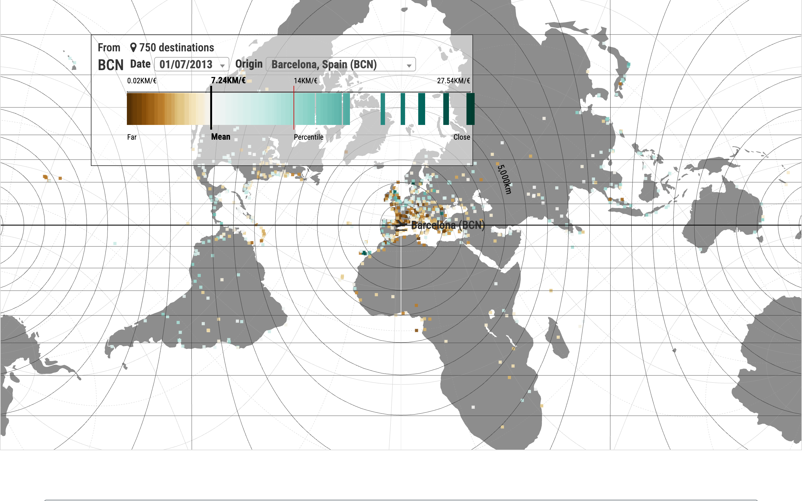
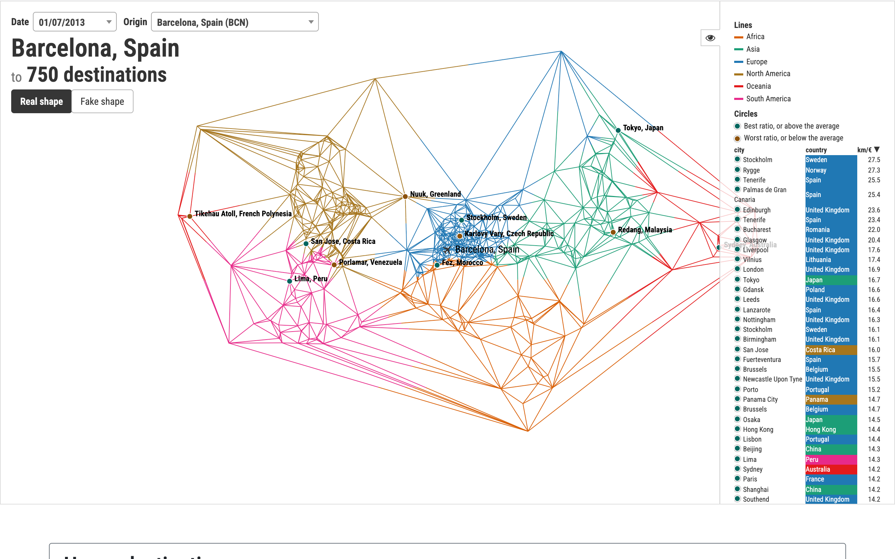
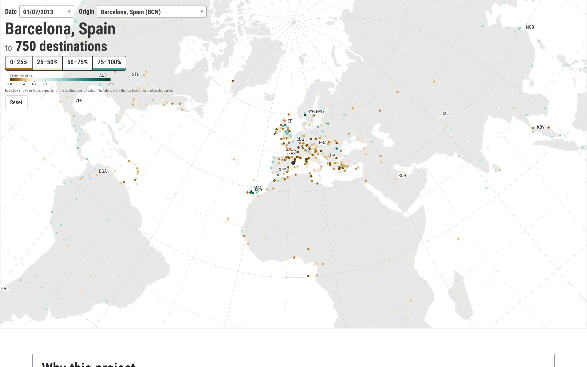

<header class="p-6">

2013 - 2026
## Pangea Low Cost
### Maps that place destinations by flight price instead of by distance.

<div class="py-4">

```js
import {stack} from "../components/stack.js";
display(stack({
  disciplines: ["dataviz", "frontend", "design"],
}));

```

</div>

*On a normal map, a city 2,000 km away always looks farther than a city 500 km away. Pangea redraws the map around your departure airport: a cheap flight pulls its destination closer, and an expensive flight pushes it away.*

```js
display(stack({
  tools: ["html", "css", "javascript", "d3"], // TODO: review (PHP backend?)
}));
```

[Visit the project](https://pangea.hermesite.net/)

</header>

<div class="d-flex flex-column gap-7">
  <figure class="m-0">
    
    <figcaption class="gallery-caption">Pangea Folding Maps</figcaption>
  </figure>
  <figure class="m-0">
    
    <figcaption class="gallery-caption">All destinations</figcaption>
  </figure>
  <figure class="m-0">
    
    <figcaption class="gallery-caption">One destination</figcaption>
  </figure>
</div>

