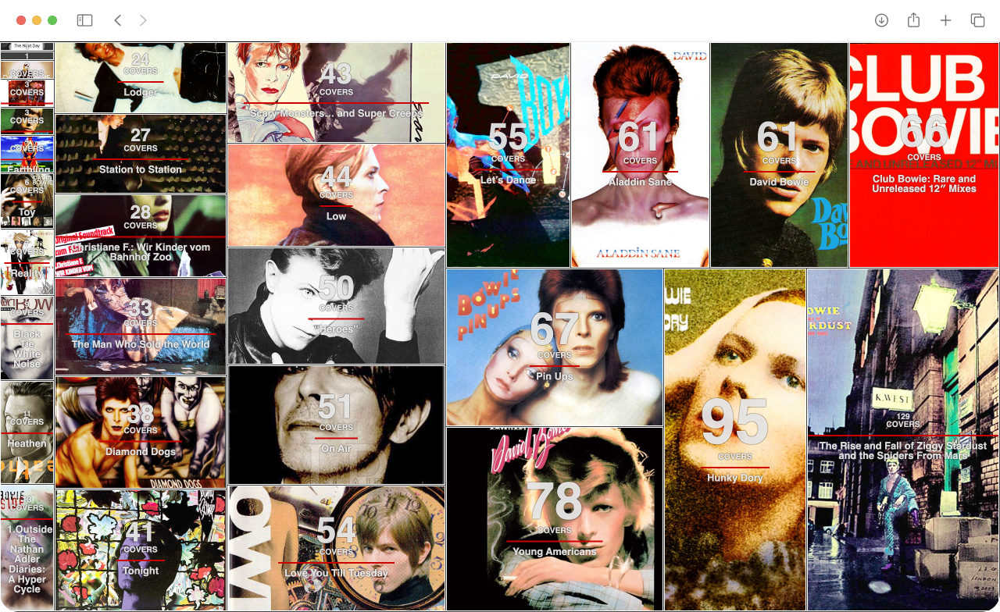
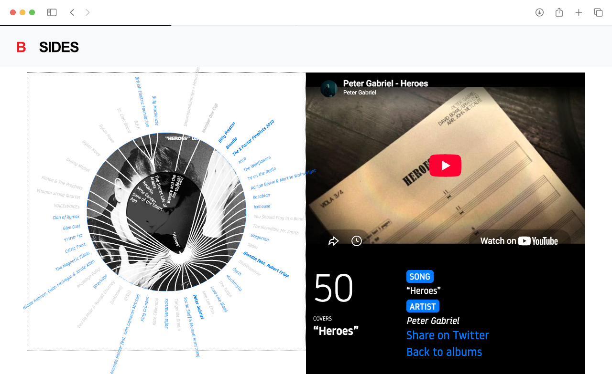
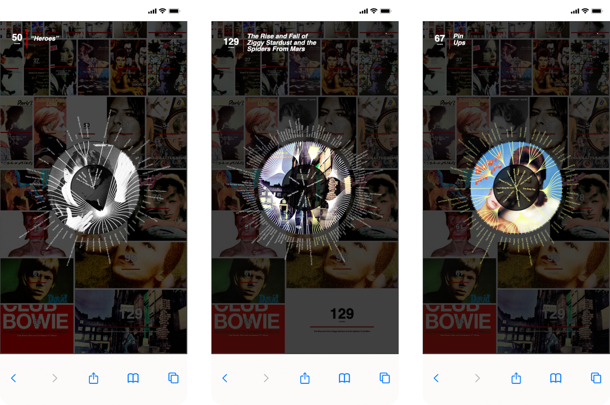

<header class="p-6 bg-primary fg-white">

2017
## David Bowie
#### Fan project tribute

<div class="py-4">

```js
import {stack} from "../components/stack.js";
display(stack({
  disciplines: ["dataviz", "frontend", "design"],
}));
```


</div>

</header>

<div class="p-6 alert theme-primary rounded-0 border-0">

*During our collaboration with Oscar Marín and [Outliers](https://outliers.es/) on the [Immersive data visualization: A brief update on our Journalism 360 grant](https://medium.com/journalism360/immersive-data-visualisation-a-brief-update-on-our-journalism-360-grant-99b37acfb3b2), we produced a data-based interactive gallery of Bowie's album covers. The result is a video playlist enriched with references to the covers and artists of David Bowie songs.*

</div>

<div class="p-6">

#### tech stack
```js
display(stack({
  tools: ["html", "css", "javascript", "d3"], // TODO: review (PHP backend?)
}));
```

</div>

<div class="p-6 bg-1">

##### Data Story
### Listen the many covers of Bowie
[Visit the project](https://wip.hermesite.net/bowie-covers/) 

This data story explores the influence of David Bowie on contemporary music and its impact on history. The data was extracted from the MusicBrainz database. The project is in Spanish.

</div>

<div class="d-flex p-6 pt-0 bg-1 gap-4">
  <figure class="m-0">
    
    <figcaption class="py-2 mt-3 fs-sm"><strong>Discography treemap:</strong> The application displays Bowie's discography, showing how many artists have covered each song from his albums.</figcaption>
  </figure>
  <figure class="m-0">
    
    <figcaption class="py-2 mt-3 fs-sm"><strong>Covers song video player:</strong> The radial chart has the dual function of showing the artists performing and allowing you to navigate between their performance videos (when available).</figcaption>
  </figure>
</div>

<div class="p-6">

##### Printable
### Data Poster Collection
[Visit the project](https://wip.hermesite.net/bowie-covers-posters/)

A series of printable posters for each album. Each song with a cover is named after the artist who recorded it.

</div>


<div class="d-flex flex-column p-6 pt-0">
  <figure class="m-0">
    
    <figcaption class="py-2 mt-3 fs-sm">'Heroes' is the song with the most cover versions, 'The Rise and Fall of Ziggy Stardust and the Spiders from Mars' is the most covered album, and 'Pin Ups' is David Bowie's album of covers.</figcaption>
  </figure>
</div>
