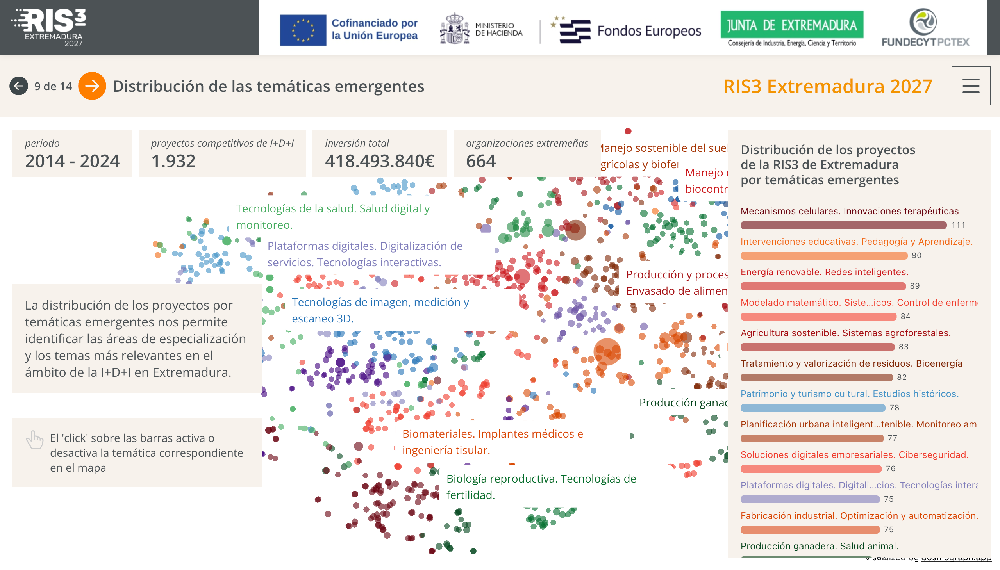
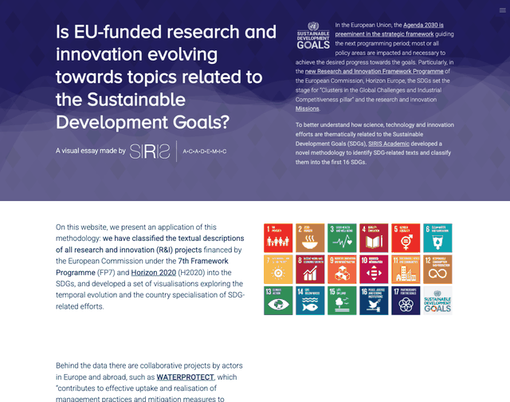
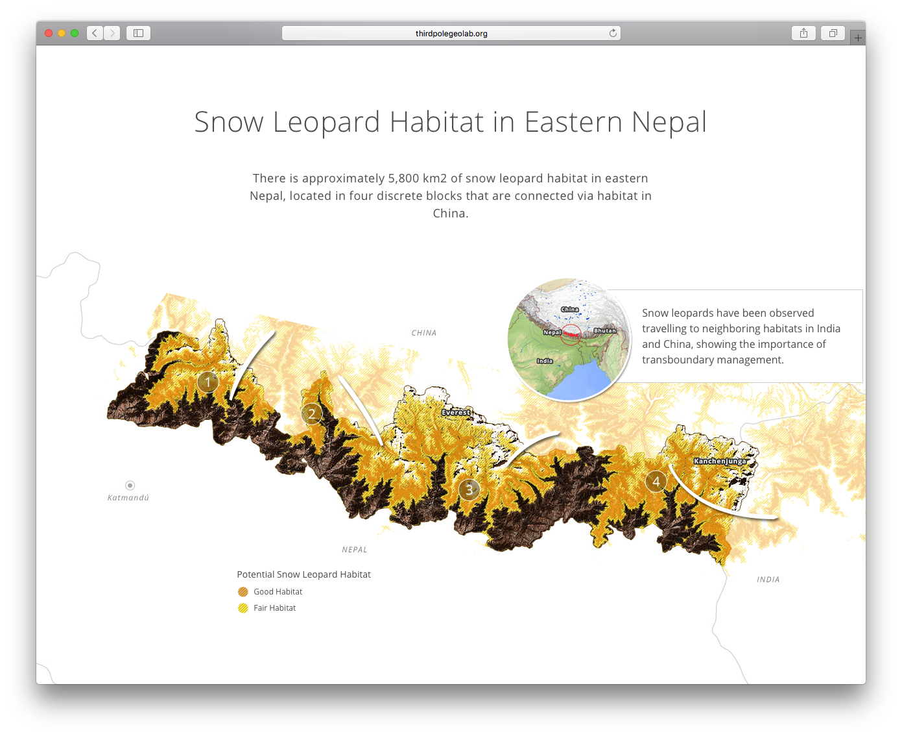

<header class="p-6 bg-secondary fg-white">

2014 - 2026 | Selected experiences 3/3
#### Data visualization: Presentation
# Interaction Design & Data Storytelling
## Narrative-driven interfaces

```js
import {stack} from "../components/stack.js";
display(stack({
  disciplines: ["dataviz", "ux", "ui", "frontend"],
}));
```

</header>

<div class="p-6 alert theme-secondary rounded-0 border-0">

*This particular selection of works during my career are a selection of data based and narrative projects. I led design and development of interactive experiences combining data visualization with storytelling—translating complex datasets into interfaces that guide users through information discovery.*

</div>

<div class="p-6">

### Process and parts


| Explore                    | Define                   | Integrate                       |
| -------------------------- | ------------------------ | ------------------------------- |
| User research and testing  | Interaction design       | Front-end development           |
| Data narrative exploration | Information architecture | Custom visualization components |
|                            | Visual storytelling      | Responsive implementation       |

</div>

<div class="p-6">


**The challenge:** Balancing narrative structure with exploratory freedom—guiding users through complex data while allowing them to discover insights independently.

**The opportunity:** Working with diverse audiences and data types, finding the right storytelling approach for each context.

</div>

<div class="container-fluid">
<!-- Start work card section -->
<div class="row rounded-9 border border-black overflow-hidden m-6">
<div class="col">
  <figure class="m-0">
    
  </figure>
</div>
<div class="col-4 p-6 ps-0">

  2025
  ### Ris3 Extremadura
  [Visit the project](https://especializacion.ris3extremadura.es/#inicio)

  *Charts and narrative revealed as the user scrolls.
  Extensive data driven visual narratives.*

  ---
  working at: [Siris Academic](https://sirisacademic.com)

</div>
</div>
<!-- End work card section -->

<div class="row rounded-9 border border-black overflow-hidden m-6">

<div class="col-4 p-6 pe-0">

2022
## La politica di coesione
[Visit project](https://monitcoesione.emr.it/ricerca_e_innovazione/)

*Collection of data stories for public administrations, policies*

- Visual systems supporting both guided narratives and open exploration.
- Interactive environments revealing insights progressively as users explore.

---
working at: [Siris Academic](https://sirisacademic.com)

</div>

<div class="col">

<div class="d-flex flex-column gap-4">

  <figure class="m-0">
    
  </figure>
</div>

</div>

</div>
<!-- Start work card section -->
<div class="row rounded-9 border border-black overflow-hidden m-6">
<div class="col">
  <figure class="m-0">
    
  </figure>
</div>
<div class="col-4 p-6 ps-0">

  2020
  ### Science for SDGs
  [Visit the project](https://science4sdgs.sirisacademic.com/)

  *Charts and narrative revealed as the user scrolls.
  Extensive data driven visual narratives.*

  ---
  working at: [Siris Academic](https://sirisacademic.com)

</div>
</div>
<!-- End work card section -->

<div class="row rounded-9 border border-black overflow-hidden m-6">

<div class="col-4 p-6 pe-0">

2017
## Third Pole Geolab
[Visit the project](http://www.thirdpolegeolab.org)

*Style and code web-template for custom interactive maps loading dynamic data*

- Integrate the GIS layers into the web environment and synchronise them with the scroll interaction.
- Structure and prepare the web components to accommodate data from different countries.


```js
import {stack} from "../components/stack.js";
display(stack({
  tools: ["html", "css", "javascript", "d3", "leaflet", "git"], // TODO: review
}));
```

---
client: [One Big Robot](https://www.onebigrobot.com/)

</div>

<div class="col">

<div class="d-flex flex-column gap-4">

  <figure class="m-0">
    
  </figure>
</div>

</div>

</div>
</div>
